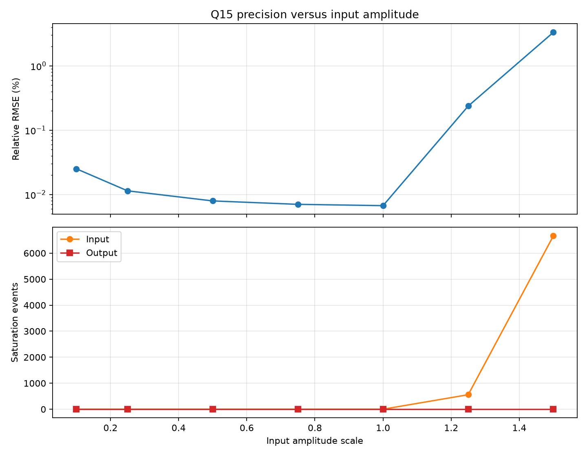

# DSP Signal Processing Laboratory

A compact, reproducible desktop project demonstrating FIR filtering, FFT-based frequency analysis, and Q15 fixed-point arithmetic using C and Python.

## Project Overview

This laboratory generates a two-tone signal with deterministic noise, filters it with matching floating-point and Q15 C implementations, and analyzes the results in Python. It reports filter attenuation, fixed-point error metrics, and amplitude sensitivity, and creates four plots in `results/`.

The project is inspired by experience working with the TI TMS320C5535 DSP during an internship. It is a desktop-based reference implementation: it does not claim to run on the TMS320C5535 or demonstrate real-time hardware performance.

## Background

- **FIR filtering** is a common DSP operation for shaping a signal's frequency content. Its finite convolution is straightforward to inspect and implement without an external DSP library.
- **FFT analysis** makes frequency components visible and helps verify the filter's effect.
- **Fixed-point arithmetic** is useful to study in embedded systems, where numeric range, scaling, rounding, saturation, and accumulator width all matter.

## Methodology

1. `python/signal_generator.py` creates the shared input CSV with a 40 Hz tone, a 220 Hz tone, and seeded Gaussian noise. Signal amplitudes are kept within the Q15 range for this experiment.
2. `c/fir_filter.c` and `c/fir_q15.c` read that exact CSV and independently filter the same samples. They share the coefficient array and filter parameters in `c/fir_common.h`.
3. `python/fft_analysis.py` loads the original and both filtered outputs, reports the strongest spectral peaks and measured 40/220 Hz tone amplitudes, and creates the time- and frequency-domain plots.
4. `python/compare_precision.py` compares the floating-point and Q15 outputs, calculating error metrics and creating the precision plot.
5. `python/amplitude_sensitivity.py` scales the same seeded composite signal, runs both compiled C filters at each scale, records error/saturation metrics, and creates the amplitude-sensitivity plot.

Intermediate CSV files are written to `results/generated/`, which is ignored by Git. The scripts recreate these files, and the final PNG plots are kept in `results/`.

## Results

Run the workflow below to generate the figures:

### Time-domain comparison


The plot compares the original input with the floating-point FIR output over the first 0.2 seconds.

### Frequency spectrum


The one-sided amplitude spectra show the original and filtered signals over the full Nyquist range. The 40 Hz component should remain prominent while the 220 Hz component is attenuated by the low-pass filter.

### Fixed-point precision comparison


The plots compare both filter outputs and show their absolute sample-by-sample difference. The comparison script prints MSE, RMSE, relative RMSE, SNR, and maximum absolute error.

### Q15 amplitude sensitivity



The experiment uses the same deterministic noise realization, tone frequencies, and shared FIR coefficients at every amplitude scale. It plots relative RMSE and reports Q15 input, coefficient, and output saturation counts. Its per-scale measurements are saved to the ignored `results/generated/amplitude_sensitivity.csv`.

### Measured results

These values were measured by running the C filters and Python analyses in this repository. Tone amplitudes are the one-sided, Hann-windowed FFT-bin amplitudes at the exact 40 Hz and 220 Hz bins; attenuation compares each filtered bin with the original input bin.

| Tone | Input amplitude | Floating-point output | Q15 output | Floating-point attenuation |
|---|---:|---:|---:|---:|
| 40 Hz (desired) | 0.54998319 | 0.54904814 (99.8300% preserved) | 0.54907105 (99.8342% preserved) | — |
| 220 Hz (rejected) | 0.25074859 | 0.00007175 (70.8681 dB attenuation) | 0.00004546 (74.8322 dB attenuation) | 70.8681 dB |

The Q15-to-floating-point comparison at the default amplitude measured MSE `6.79288499936e-10`, RMSE `2.60631636594e-05`, relative RMSE `0.006712%`, SNR `83.462594 dB`, and maximum absolute error `6.69679803279e-05`. Q15 reported zero input, coefficient, and output saturations.

| Input scale | Relative RMSE | SNR | Maximum absolute error | Input / coefficient / output saturation events |
|---:|---:|---:|---:|---:|
| 0.10 | 0.025081% | 72.013 dB | 2.6078969e-05 | 0 / 0 / 0 |
| 0.25 | 0.011411% | 78.853 dB | 3.6445963e-05 | 0 / 0 / 0 |
| 0.50 | 0.007949% | 81.994 dB | 4.2662530e-05 | 0 / 0 / 0 |
| 0.75 | 0.007033% | 83.057 dB | 5.1690041e-05 | 0 / 0 / 0 |
| 1.00 | 0.006712% | 83.463 dB | 6.6967980e-05 | 0 / 0 / 0 |
| 1.25 | 0.237342% | 52.493 dB | 0.014669677 | 558 / 0 / 0 |
| 1.50 | 3.324589% | 29.565 dB | 0.060536830 | 6,662 / 0 / 0 |

Input saturation events count Q15 input conversions that clipped, not unique sample indices: the FIR converts a sample again for each tap that uses it. The tested scales above 1.0 exceed Q15's representable input range for some samples; this explains their sharp error increase. No coefficient or output saturation occurred in this sweep.

## Technical Concepts

### FIR convolution

For input `x[n]` and coefficients `h[k]`, the causal FIR output is:

`y[n] = sum(h[k] * x[n-k])`

The implementation omits terms whose input index is before zero, so the output starts with the expected filter startup transient. The shared source of truth is [`c/fir_common.h`](c/fir_common.h): it defines the 1,000 Hz design sample rate, 100 Hz cutoff, 31 taps, Hamming window, and the complete normalized coefficient array. Both C programs include this same array rather than maintaining separate coefficient copies. The signal generator and FFT analysis read the sample rate from this header through `python/fir_config.py`, keeping generated data and frequency axes aligned with the filter design.

### Sampling and FFT frequency resolution

The sample rate is 1,000 Hz, so the Nyquist frequency is 500 Hz. For `N` samples, the FFT bin spacing is `sample_rate / N`; with this experiment's 2,000 samples, it is 0.5 Hz. Bin spacing is not the same as the ability to resolve nearby tones, which also depends on the observation window and signal duration. The analysis uses a Hann window to reduce spectral leakage and normalizes the one-sided real-signal spectrum for amplitude comparison.

### Q15 representation and quantization

Q15 stores a signed 16-bit integer `q` representing approximately `q / 32768`. Its representable range is `-1` through `1 - 2^-15` (about `0.9999695`). The Q15 filter rounds input and coefficient conversions, accumulates Q15 products in a signed 64-bit accumulator, rounds when scaling the Q30 sum back to Q15, and saturates values outside the representable range. It reports input, coefficient, and output saturation counts to standard error.

Quantization maps a continuous set of values to a finite set of representable values. The resulting rounding and coefficient errors explain the difference between the Q15 and floating-point outputs. Saturation is reported separately so clipping is not mistaken for ordinary quantization error.

### Precision and attenuation metrics

For the precision comparison, `y_float[n]` is the C floating-point output, `y_Q15[n]` is the C fixed-point output converted back to a real value, and `e[n] = y_float[n] - y_Q15[n]`. Metrics are calculated over all output samples, including the filter startup transient:

- **MSE**: `sum(e[n]^2) / N`.
- **RMSE**: `sqrt(MSE)`.
- **Relative RMSE**: `RMSE / sqrt(sum(y_float[n]^2) / N) * 100%`. The denominator is the RMS of the floating-point reference.
- **SNR**: `10 * log10(sum(y_float[n]^2) / sum(e[n]^2))` dB, using the floating-point output as signal and the difference as error.
- **Maximum absolute error**: `max(abs(e[n]))`.

For each known tone, the analysis reads its amplitude from the corresponding one-sided Hann-windowed FFT bin. **Attenuation** is `20 * log10(input_bin_amplitude / filtered_bin_amplitude)` dB, and **preservation** is `100 * filtered_bin_amplitude / input_bin_amplitude` percent. The rejected-tone bin is close to the filtered noise floor, so its reported attenuation is a measured bin result for this seeded signal, not a filter-wide stop-band guarantee.

## Installation and Execution

Requirements: Python 3 and GCC (or a compatible C compiler supporting C11).

### 1. Install and build (one time)

From the repository root, create a virtual environment and install the Python dependencies:

```powershell
py -m venv .venv
.\.venv\Scripts\python.exe -m pip install -r requirements.txt
```

PowerShell activation is not required. The commands below invoke the virtual environment's Python directly, avoiding execution-policy issues.

Compile both C programs with GCC:

```powershell
gcc -std=c11 -O2 c\fir_filter.c -lm -o fir_filter.exe
gcc -std=c11 -O2 c\fir_q15.c -lm -o fir_q15.exe
```

Repeat these setup steps only if you recreate the virtual environment or change the C source.

### 2. Run the experiments

After setup, run the following from the repository root to regenerate the input, run both filters, and create all plots and metrics:

```powershell
.\.venv\Scripts\python.exe python\signal_generator.py
.\fir_filter.exe results\generated\input.csv results\generated\filtered_float.csv
.\fir_q15.exe results\generated\input.csv results\generated\filtered_q15.csv
.\.venv\Scripts\python.exe python\fft_analysis.py
.\.venv\Scripts\python.exe python\compare_precision.py
.\.venv\Scripts\python.exe python\amplitude_sensitivity.py
```

The FFT and precision scripts read the generated CSV files and fail with a clear error if their prerequisites are missing. The sensitivity script invokes both compiled filters for each amplitude scale and requires the compiled executables from the setup step. Running the commands again regenerates all intermediate data from scratch. Generated CSVs remain under `results/generated/`, which is ignored by Git. The scripts print spectral peaks, attenuation, precision metrics, and sensitivity results to the console.

On systems with a different C compiler, compile the two C sources separately and pass each executable the same input and output CSV paths. The `c/fir_common.h` file must remain beside the C source files when compiling.

## Limitations

- The implementation runs on a desktop environment.
- Real-time execution on the TI TMS320C5535 has not been verified.
- The results do not establish TMS320C5535-specific behavior or hardware performance.
- The Q15 implementation is an educational reference and does not attempt to reproduce the C5535's exact arithmetic or instruction behavior.
