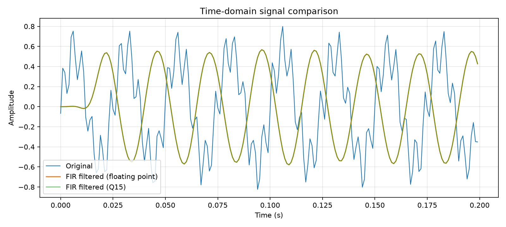
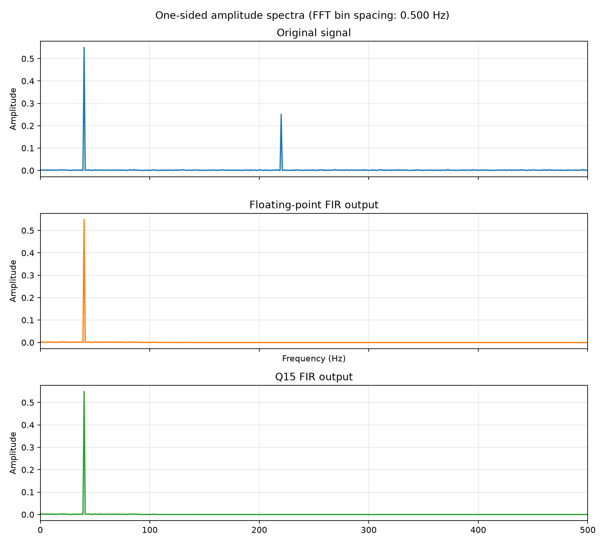
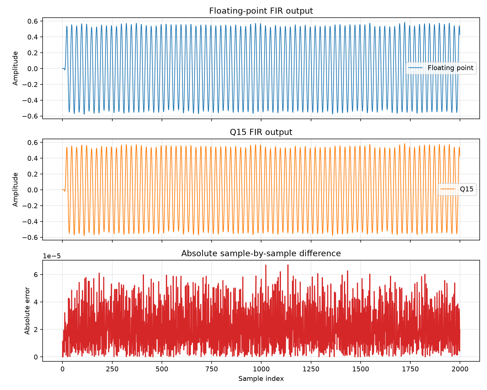

# DSP Signal Processing Laboratory

A compact, reproducible desktop project demonstrating FIR filtering, FFT-based frequency analysis, and Q15 fixed-point arithmetic using C and Python.

## Project Overview

This laboratory generates a two-tone signal with deterministic noise, filters it with matching floating-point and Q15 C implementations, and analyzes the results in Python. It reports dominant spectral peaks and precision error, and creates three plots in `results/`.

The project is inspired by experience working with the TI TMS320C5535 DSP during an internship. It is a desktop-based reference implementation: it does not claim to run on the TMS320C5535 or demonstrate real-time hardware performance.

## Background

- **FIR filtering** is a common DSP operation for shaping a signal's frequency content. Its finite convolution is straightforward to inspect and implement without an external DSP library.
- **FFT analysis** makes frequency components visible and helps verify the filter's effect.
- **Fixed-point arithmetic** is useful to study in embedded systems, where numeric range, scaling, rounding, saturation, and accumulator width all matter.

## Methodology

1. `python/signal_generator.py` creates the shared input CSV with a 40 Hz tone, a 220 Hz tone, and seeded Gaussian noise. Signal amplitudes are kept within the Q15 range for this experiment.
2. `c/fir_filter.c` and `c/fir_q15.c` read that exact CSV and independently filter the same samples. They share the coefficient array and filter parameters in `c/fir_common.h`.
3. `python/fft_analysis.py` loads the original and both filtered outputs, reports the strongest spectral peaks, and creates the time- and frequency-domain plots.
4. `python/compare_precision.py` compares the floating-point and Q15 outputs and creates the precision plot.

Intermediate CSV files are written to `results/generated/`, which is ignored by Git. The scripts recreate these files, and the final PNG plots are kept in `results/`.

## Results

Run the workflow below to generate the figures:

### Time-domain comparison



The plot compares the original input with the floating-point FIR output over the first 0.2 seconds.

### Frequency spectrum



The one-sided amplitude spectra show the original and filtered signals over the full Nyquist range. The 40 Hz component should remain prominent while the 220 Hz component is attenuated by the low-pass filter.

### Fixed-point precision comparison



The plots compare both filter outputs and show their absolute sample-by-sample difference. The comparison script also prints MSE, RMSE, and maximum absolute error.

## Technical Concepts

### FIR convolution

For input `x[n]` and coefficients `h[k]`, the causal FIR output is:

`y[n] = sum(h[k] * x[n-k])`

The implementation omits terms whose input index is before zero, so the output starts with the expected filter startup transient. The shared source of truth is [`c/fir_common.h`](c/fir_common.h): it defines the 1,000 Hz design sample rate, 100 Hz cutoff, 31 taps, Hamming window, and the complete normalized coefficient array. Both C programs include this same array rather than maintaining separate coefficient copies. The signal generator and FFT analysis read the sample rate from this header through `python/fir_config.py`, keeping generated data and frequency axes aligned with the filter design.

### Sampling and FFT frequency resolution

The sample rate is 1,000 Hz, so the Nyquist frequency is 500 Hz. For `N` samples, the FFT bin spacing is `sample_rate / N`; with this experiment's 2,000 samples, it is 0.5 Hz. Bin spacing is not the same as the ability to resolve nearby tones, which also depends on the observation window and signal duration. The analysis uses a Hann window to reduce spectral leakage and normalizes the one-sided real-signal spectrum for amplitude comparison.

### Q15 representation and quantization

Q15 stores a signed 16-bit integer `q` representing approximately `q / 32768`. Its representable range is `-1` through `1 - 2^-15` (about `0.9999695`). The Q15 filter rounds input and coefficient conversions, accumulates Q15 products in a signed 64-bit accumulator, rounds when scaling the Q30 sum back to Q15, and saturates values outside the representable range. It reports input, coefficient, and output saturation counts to standard error.

Quantization maps a continuous set of values to a finite set of representable values. The resulting rounding and coefficient errors explain the difference between the Q15 and floating-point outputs. Saturation is reported separately so clipping is not mistaken for ordinary quantization error.

## Installation and Execution

Requirements: Python 3, NumPy, Matplotlib, and GCC (or a compatible C compiler supporting C11).

From the repository root, create a virtual environment and install the Python dependencies:

```powershell
py -m venv .venv
.\.venv\Scripts\Activate.ps1
python -m pip install -r requirements.txt
```

Compile the C programs with GCC on Windows:

```powershell
gcc -std=c11 -O2 c\fir_filter.c -lm -o fir_filter.exe
gcc -std=c11 -O2 c\fir_q15.c -lm -o fir_q15.exe
```

Then regenerate the shared input, run both filters, and create all three plots:

```powershell
python python\signal_generator.py
.\fir_filter.exe results\generated\input.csv results\generated\filtered_float.csv
.\fir_q15.exe results\generated\input.csv results\generated\filtered_q15.csv
python python\fft_analysis.py
python python\compare_precision.py
```

The Python analysis scripts read the generated CSV files and fail with a clear error if their prerequisites are missing. Run the generator and both C programs again to reproduce all intermediate data from scratch. The scripts print spectral peaks and precision metrics to the console.

On systems with a different C compiler, compile the two C sources separately and pass each executable the same input and output CSV paths. The `c/fir_common.h` file must remain beside the C source files when compiling.

## Limitations

- The implementation runs on a desktop environment.
- Real-time execution on the TI TMS320C5535 has not been verified.
- The results do not establish TMS320C5535-specific behavior or hardware performance.
- The Q15 implementation is an educational reference and does not attempt to reproduce the C5535's exact arithmetic or instruction behavior.
